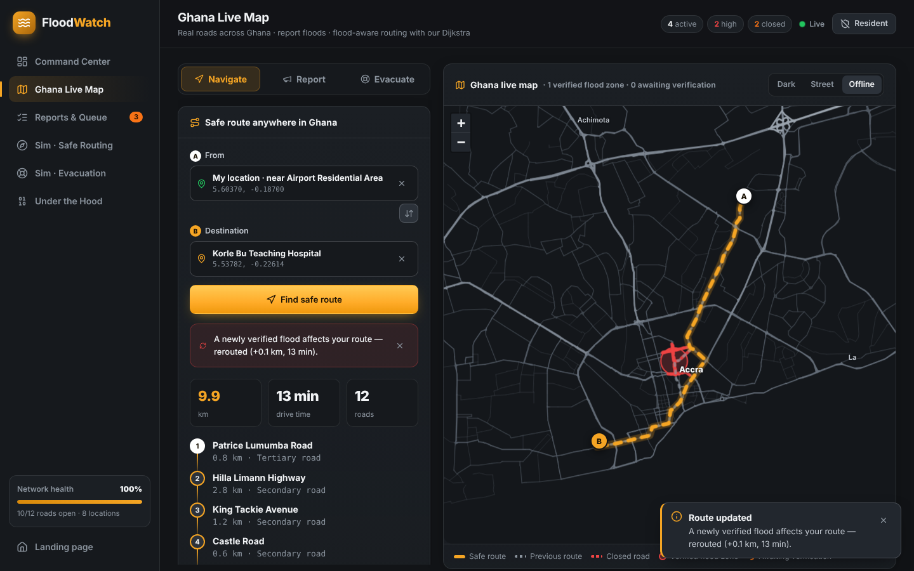
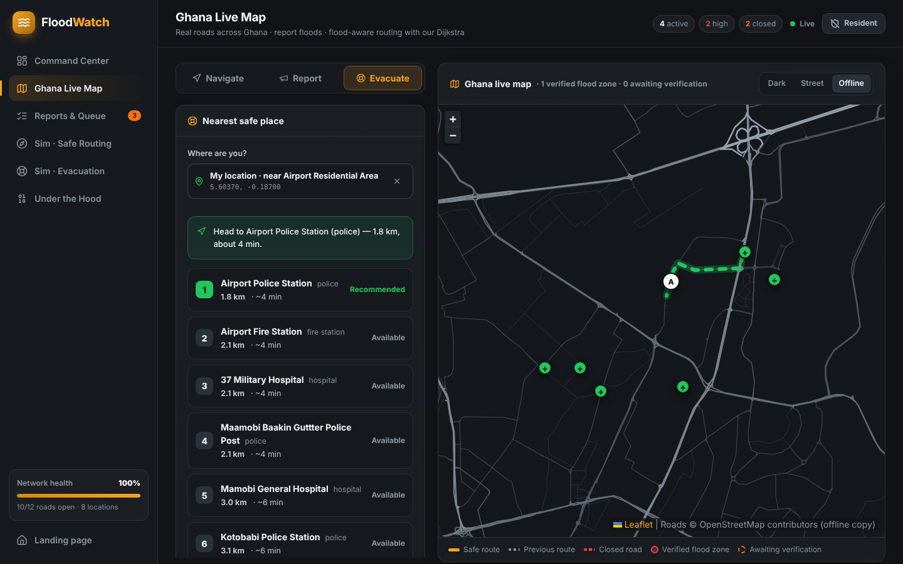
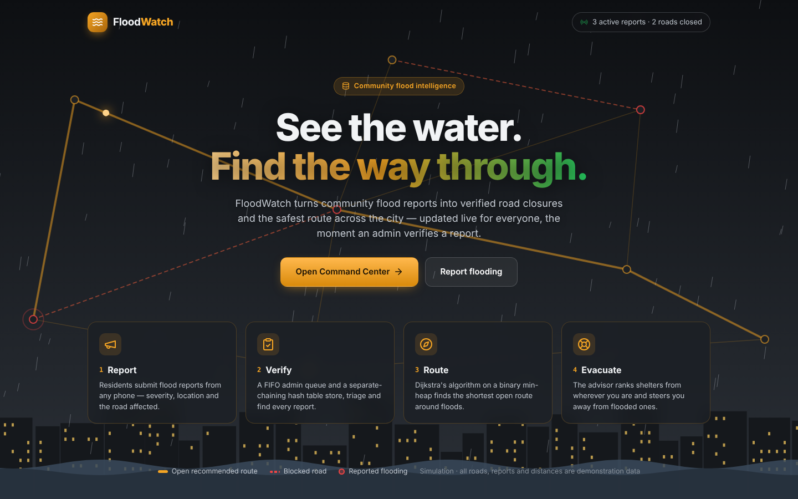
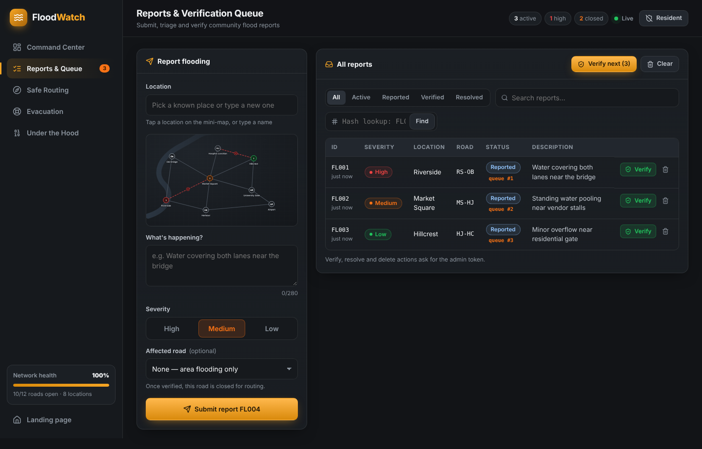
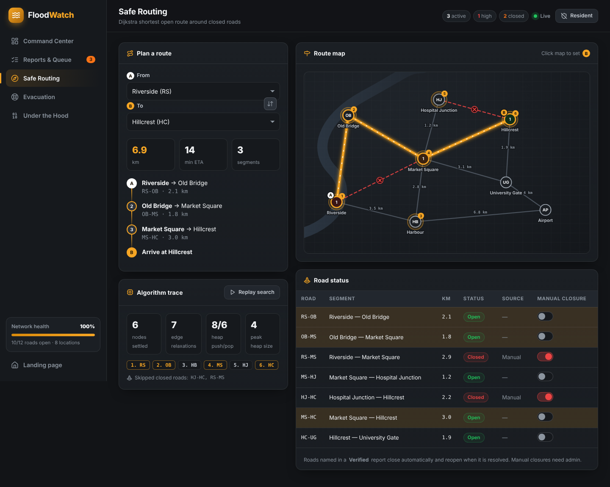
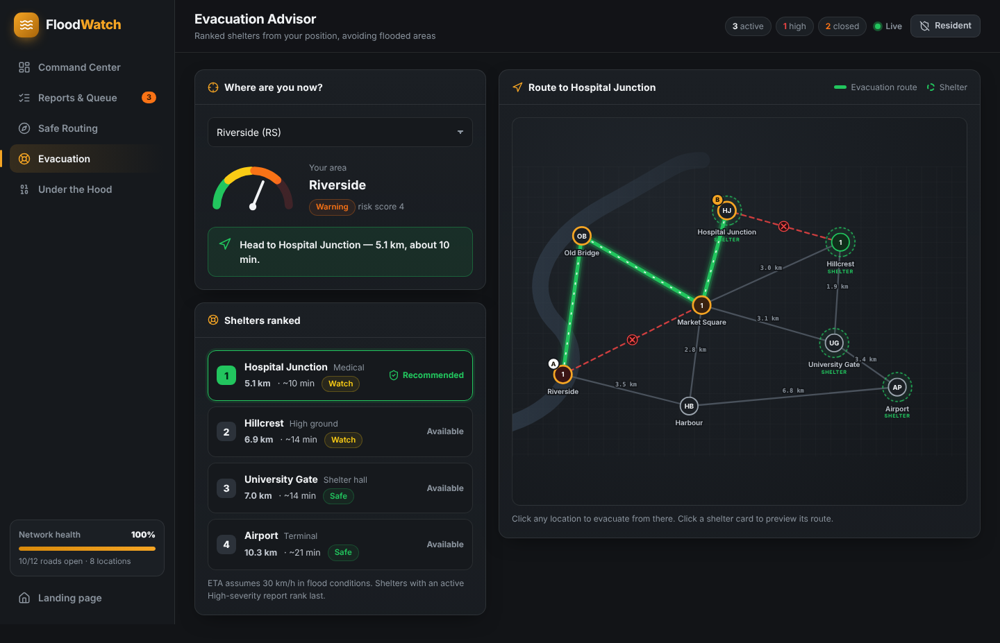
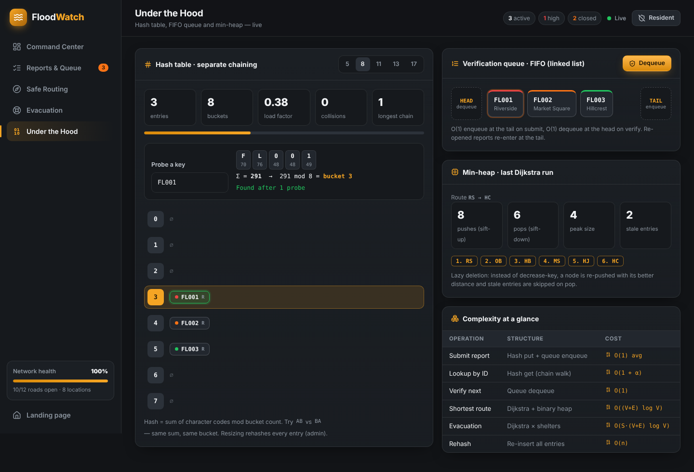
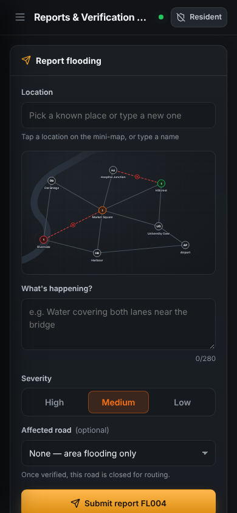
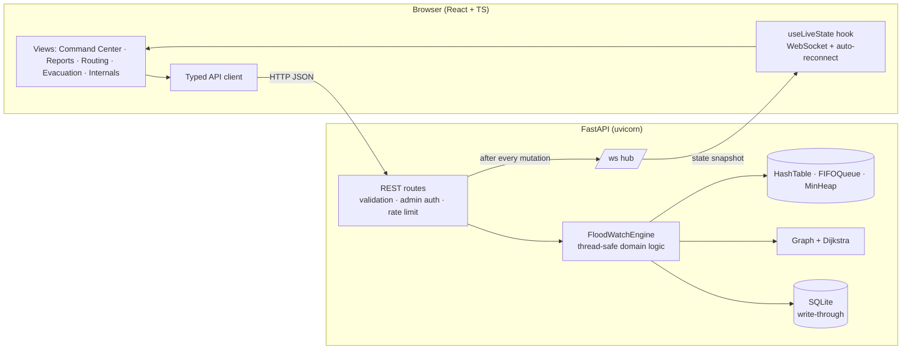

# 🌊 FloodWatch

**Community flood reporting and safe-route recommendation.** It runs as a full-stack web app with live updates.

Residents report flooding from any phone. Admins verify reports through a FIFO queue. Each verified report closes its road in a live road network. Dijkstra's algorithm, running on a hand-built min-heap, then recommends the shortest open route and the nearest safe shelter. Every connected screen updates as soon as the network changes.

> FloodWatch 2.0 rebuilds the original Tkinter desktop prototype (`legacy_tkinter_app.py`). It now has a FastAPI backend, a React + TypeScript frontend, SQLite persistence and live updates over WebSocket. The core data structures are still written from scratch.



---

## Table of contents

1. [Features](#features)
2. [Screenshots](#screenshots)
3. [Architecture](#architecture)
4. [Tech stack](#tech-stack)
5. [Project structure](#project-structure)
6. [Quick start](#quick-start)
7. [Using FloodWatch (demo walkthrough)](#using-floodwatch-demo-walkthrough)
8. [Configuration](#configuration)
9. [API reference](#api-reference)
10. [Data structures & algorithms](#data-structures--algorithms)
11. [Development](#development)
12. [Testing](#testing)
13. [Deployment](#deployment)
14. [Security](#security)
15. [What changed from the Tkinter version](#what-changed-from-the-tkinter-version)
16. [Limitations & roadmap](#limitations--roadmap)
17. [Troubleshooting](#troubleshooting)

---

## Features

| Area | What it does |
|---|---|
| **Landing page** | Animated storm scene with rain, the road network, a traveller moving along the safe route, the city skyline and a rising tide. It also shows live headline stats. |
| **Ghana Live Map** | Real roads across all of Ghana (45,928 junctions, 76,620 km, from OpenStreetMap). Pick any place by **device GPS ("My location")**, **search** (17,343 towns, suburbs, hospitals, schools, markets…) or **tapping the map**. Report floods at real coordinates. Get a **flood-aware safe route** from our own Dijkstra. If the destination is flooded, you're routed to the nearest safe point outside the zone. If a flood is verified on your route mid-trip, you're **rerouted live**. Evacuation finds the nearest reachable hospital, police or fire station. Has an **Offline** base map drawn from our own road data. |
| **Command Center** | KPI cards (active, high severity, queue, closed roads, network connectivity), a live interactive map, an activity feed, risk hotspots and a queue preview. |
| **Reports & Queue** | Mobile-friendly report form with a tap-to-pick mini-map. Tapping a node selects a known place; tapping empty space drops a pin for a new location. The reports table has filters, search, an inline hash-table lookup and admin actions (verify, resolve, reopen, delete, clear). |
| **Safe Routing** | Pick A and B from the dropdowns or by clicking the map. Shows the shortest open route, distance, ETA and turn-by-turn segments. **Animated Dijkstra replay** lights nodes up in the order they are settled, with heap push/pop/peak counters. A road table has closure switches. |
| **Evacuation Advisor** | A risk gauge for your area and shelters ranked by distance. Shelters with an active High-severity report are flagged and ranked last. The map shows a green evacuation route. |
| **Under the Hood** | Live view of the hash-table buckets: probe any key to see Σchar → mod → bucket and the chain walk. Also shows the FIFO queue lane, min-heap stats from the last Dijkstra run and a complexity table. Admins can resize the hash table (5/8/11/13/17 buckets). |
| **Realtime** | A WebSocket pushes a fresh snapshot to every client after each change. The client reconnects automatically with exponential backoff. |
| **Persistence** | SQLite write-through: reports, the queue order, custom locations, closures and the activity log all survive restarts. |
| **Roles** | Residents can report, look up and route without signing in. Admin actions need a server-side token. |
| **Dynamic network** | A report for an unknown place creates a new map node. It is placed at the user's pin or auto-placed away from other nodes, then linked to its 2 nearest neighbours. |

## Screenshots

| | |
|---|---|
|  |  |
|  |  |
|  |  |
|  |  |

## Architecture



**Request lifecycle (for example, "Verify next"):**

1. The browser sends `POST /api/queue/process` with an `X-Admin-Token` header.
2. FastAPI checks the token. The engine dequeues from the `FIFOQueue`, finds the report in the `HashTable`, sets it to `Verified`, recalculates closed roads and writes to SQLite.
3. The hub broadcasts a new state snapshot to every WebSocket client.
4. Every open screen re-renders: map, KPIs, queue and activity feed. Open routes and evacuation plans fetch again, so they now avoid the closed road.

**Design choices**

- **The in-memory engine is the source of truth, and SQLite keeps it durable.** The data structures *are* the project, so they stay authoritative and observable. SQLite (built into Python) makes state survive restarts with nothing to install.
- **One process serves everything.** The built SPA is served by FastAPI from `backend/static`. That means one port, no CORS in production, and one command to run.
- **Snapshots, not diffs, over WebSocket.** The state is a few KB, so full snapshots keep the client simple and always consistent.
- **Routing is computed on the server.** All clients get the same answer, and the algorithm trace comes back with it for visualisation.

## Tech stack

| Layer | Technology |
|---|---|
| Backend | Python 3.10–3.13, FastAPI, Pydantic v2, Uvicorn, WebSockets |
| Storage | SQLite (stdlib `sqlite3`, WAL mode) |
| Frontend | React 18, TypeScript 5, Vite 5, lucide-react icons, hand-written CSS design system, SVG map, Canvas landing animation |
| Maps | Leaflet 1.9, OpenStreetMap / CARTO base maps, offline canvas road layer; road graph built with pyosmium from the Geofabrik Ghana extract |
| Tests | pytest + FastAPI TestClient (unit, edge cases, randomised cross-check, API, WebSocket, real Ghana network); matplotlib benchmarks |
| Packaging | `requirements.txt` (pinned), `run.sh` / `run.bat`, multi-stage `Dockerfile` |

## Project structure

```
floodwatch/
├── requirements.txt          # pinned Python runtime dependencies
├── requirements-dev.txt      # + pytest, httpx2, matplotlib (tests & benchmarks)
├── run.sh / run.bat          # one-command start (creates venv, installs, runs)
├── Dockerfile                # builds frontend + runs backend
├── render.yaml               # Render Blueprint (one-click hosting)
├── .env.example              # configuration template
├── legacy_tkinter_app.py     # original desktop prototype (reference)
├── docs/                     # design doc, test report, slides, video, diagrams, benchmarks, screenshots
├── backend/
│   ├── app/
│   │   ├── main.py           # FastAPI app: routes, auth, rate limit, WebSocket hub, SPA serving
│   │   ├── engine.py         # domain logic: reports, queue, closures, routing, evacuation, snapshot
│   │   ├── structures.py     # HashTable (separate chaining), MinHeap, FIFOQueue (linked list)
│   │   ├── graph.py          # adjacency list, Dijkstra with trace, connectivity metric
│   │   ├── store.py          # SQLite schema + write-through persistence
│   │   ├── seed.py           # demo network (8 locations, 12 roads, 3 reports)
│   │   ├── geo.py            # Ghana map: spatial hashing, flood zones, safe routing, search
│   │   └── data/ghana_graph.json.gz   # Ghana road graph built from OpenStreetMap (3.8 MB)
│   ├── static/               # PRE-BUILT frontend (served at /) — no Node needed to run
│   ├── data/                 # SQLite DB (created at runtime, git-ignored)
│   ├── tools/build_ghana_graph.py   # one-time OSM → graph converter
│   ├── tests/                # pytest suite (46 tests)
│   └── bench/                # benchmarks + diagram generator
└── frontend/
    ├── package.json / package-lock.json
    ├── vite.config.ts        # dev proxy → :8000, build → ../backend/static
    └── src/
        ├── App.tsx           # hash router
        ├── styles.css        # design system
        ├── lib/api.ts        # typed API client
        ├── lib/live.ts       # WebSocket live-state hook
        ├── components/       # Shell (nav/topbar/admin), NetworkMap (SVG), UI kit
        └── views/            # Landing, Dashboard, Reports, Routing, Evacuation, Internals
```

## Quick start

### Prerequisites

| Need | Version | Notes |
|---|---|---|
| **Python** | 3.10 – 3.13 | Required. On Windows, tick "Add Python to PATH" during install. |
| Node.js | 18+ (22 recommended) | **Only** needed if you change the frontend. A built copy already ships in `backend/static`. |
| Docker | any recent | Optional, for container deployment. |

### Option A: one command

**Windows** (double-click it, or run in PowerShell / CMD):
```bat
run.bat
```

**macOS / Linux:**
```bash
./run.sh
```

The script creates a `.venv`, installs `requirements.txt` and starts the server. Then open **http://localhost:8000**.

### Option B: manual setup

```bash
# 1. Create and activate a virtual environment
python -m venv .venv
# Windows:      .venv\Scripts\activate
# macOS/Linux:  source .venv/bin/activate

# 2. Install dependencies
pip install -r requirements.txt

# 3. Run (from the backend folder)
cd backend
uvicorn app.main:app --host 0.0.0.0 --port 8000
```

| URL | What |
|---|---|
| http://localhost:8000 | The app |
| http://localhost:8000/api/docs | Interactive API docs (Swagger UI) |
| http://localhost:8000/api/health | Health check |

**Admin token (demo default):** `floodwatch-admin`. Change it before showing the app to anyone (see [Configuration](#configuration)).

To reach the app from phones on the same Wi-Fi, use `http://<your-PC-LAN-IP>:8000`. On Windows, allow Python through the firewall when prompted.

## Using FloodWatch (demo walkthrough)

This 3-minute script shows every part of the system:

1. **Landing page.** Click **Open Command Center**.
2. **Open a second tab or a phone** at the same URL to show live sync.
3. **Report flooding** (resident, no sign-in needed). Go to *Reports & Queue*, type a new place such as `Kaneshie Market`, tap empty space on the mini-map to pin it, choose **High** and submit. The node appears on every screen at once, linked to its 2 nearest locations.
4. **Verify** (admin). Click **Verify next** and enter the admin token. FL001 (the oldest in the FIFO queue) becomes *Verified* and its road `RS-OB` closes.
5. **Safe Routing.** Go from Riverside → Hillcrest and watch Dijkstra replay: nodes light up in settle order, then the route draws. Close or reopen roads with the switches and the route updates live.
6. **Evacuation.** From Riverside, the gauge shows area risk and the shelters are ranked. Report a **High** flood at Hospital Junction and verify it: that shelter drops to *Flooded – avoid* and the recommendation moves.
7. **Ghana Live Map.** Under *Navigate*, choose **My location** and search **Korle Bu Teaching Hospital**, then press **Find safe route**. In another tab, report a **High** flood on that route under *Report* and verify it as admin. The first tab shows **"rerouted"**, with the old route dashed. Set the destination inside the flood and the route ends at the nearest safe point instead.
8. **Under the Hood.** Probe `FL004`, or `AB` vs `BA`, to see hashing and chain walks. Switch bucket sizes to rehash live, and watch the queue lane drain as you verify.

**Roles**

| Action | Resident | Admin |
|---|:-:|:-:|
| View map, reports, routing, evacuation | ✅ | ✅ |
| Submit a report / hash lookup | ✅ | ✅ |
| Verify / resolve / reopen / delete / clear reports | | ✅ |
| Close or reopen roads, resize hash table, reset demo | | ✅ |

**Report lifecycle:** `Reported` (in the queue) → `Verified` (its road closes) → `Resolved` (its road reopens). Reopening a resolved report puts it back at the tail of the queue.

## Ghana live map

**Map data ships with the project** (`backend/app/data/ghana_graph.json.gz`), so nothing extra needs downloading. To rebuild it from fresh OpenStreetMap data:

```bash
pip install osmium
# download https://download.geofabrik.de/africa/ghana-latest.osm.pbf  (≈117 MB)
cd backend
python tools/build_ghana_graph.py ghana-latest.osm.pbf app/data/ghana_graph.json.gz   # ≈1 minute
```

- **Base map images** come from OpenStreetMap/CARTO and need internet in the browser. If they fail to load, the app switches to **Offline** mode automatically and draws Ghana's roads from FloodWatch's own data. You can also choose Offline with the button on the map.
- **"My location" needs a secure page.** Browsers only share GPS on `https://` or on `http://localhost`. On the laptop running the server, it works at `http://localhost:8000`. For phones on the same Wi-Fi, either search or tap the map, or put the app behind HTTPS (for example `cloudflared tunnel --url http://localhost:8000`).
- **Coverage:** motorway → tertiary and unclassified roads across all of Ghana. Small residential side-streets are left out to keep routing fast, so a start or destination snaps to the nearest included road (usually within a few hundred metres in towns).
- **Flood zones:** a *verified* GPS report closes every road segment within **400 m (High), 200 m (Medium) or 80 m (Low)**. Unverified reports appear as dashed circles but don't affect routes. Roads reopen when the report is resolved.
- **Attribution:** road and place data © OpenStreetMap contributors, licensed under ODbL. The map credits it on screen.

## Configuration

All settings are environment variables and all are optional. Copy `.env.example` to `.env` in the project root; the app reads it automatically at start-up. You can also set them in your shell or in Docker.

| Variable | Default | Purpose |
|---|---|---|
| `FLOODWATCH_ADMIN_TOKEN` | `floodwatch-admin` | Secret for admin actions. **Set a long random value in any shared deployment.** |
| `FLOODWATCH_DB` | `backend/data/floodwatch.db` | SQLite file path. Delete the file to reset to the demo data. |
| `FLOODWATCH_RATE_LIMIT` | `12` | Report submissions allowed per IP per minute. |
| `FLOODWATCH_CORS` | `http://localhost:5173` | Comma-separated allowed origins (only needed for the Vite dev server or other front-ends). |
| `FLOODWATCH_STATIC` | `backend/static` | Folder containing the built frontend. |
| `FLOODWATCH_CARTO_KEY` | unset | Free CARTO basemap key for the **Dark** map style ([get one](https://carto.com/basemaps/apikey)). Without it, Dark uses OpenStreetMap tiles with a dark filter. Allow `localhost` and your Render domain in the key's website restrictions. |
| `FLOODWATCH_DISABLE_GEO` | unset | Set to `1` to skip loading the Ghana map (saves about 1 s at start-up and about 150 MB RAM). |

Generate a strong token:
```bash
python -c "import secrets; print(secrets.token_urlsafe(32))"
```

## API reference

Base path: `/api`. Full interactive docs are at `/api/docs`. Admin endpoints need the header `X-Admin-Token: <token>`.

| Method | Path | Auth | Description |
|---|---|:-:|---|
| GET | `/api/health` | | Liveness, state version, connected clients |
| GET | `/api/state` | | Full snapshot: locations, roads, reports, queue, hash layout, stats, events |
| POST | `/api/reports` | rate-limited | Submit `{location, description, severity, roadId?, x?, y?}`, or with `lat, lon` for a Ghana-map report |
| GET | `/api/reports/lookup/{id}` | | Hash-table lookup with probe trace |
| PATCH | `/api/reports/{id}` | 🔒 | Set `{status: Reported\|Verified\|Resolved}` |
| DELETE | `/api/reports/{id}` | 🔒 | Delete one report |
| DELETE | `/api/reports` | 🔒 | Clear all reports |
| POST | `/api/queue/process` | 🔒 | Dequeue and verify the next report (FIFO) |
| PUT | `/api/roads/{id}/block` | 🔒 | Manual closure `{blocked: true\|false}` |
| GET | `/api/route?from=RS&to=HC` | | Shortest open route + Dijkstra trace |
| GET | `/api/evacuate?from=RS` | | Ranked shelters + advice |
| GET | `/api/geo/info` | | Ghana network size, sources, spatial-index stats |
| GET | `/api/geo/search?q=korle bu` | | Place search (binary search) |
| GET | `/api/geo/reverse?at=5.60,-0.19` | | Nearest named place to a coordinate |
| GET | `/api/geo/route?from=lat,lon&to=lat,lon` | | Flood-aware safe route on real roads (+ warnings, safe point, algorithm stats) |
| GET | `/api/geo/evacuate?at=lat,lon` | | Nearest reachable hospitals / police / fire stations |
| GET | `/api/geo/offline-roads` | | Compressed road shapes for the offline base map |
| PUT | `/api/hash/size` | 🔒 | Rehash into `{size: 5\|8\|11\|13\|17}` buckets |
| POST | `/api/auth/verify` | 🔒 | Check an admin token |
| POST | `/api/admin/reset` | 🔒 | Restore the demo dataset |
| WS | `/ws` | | Receives `{"type":"state","data":<snapshot>}` on connect and after every change. Send `"ping"` to keep alive. |

Example:
```bash
curl -X POST localhost:8000/api/reports -H "Content-Type: application/json" \
  -d '{"location":"Harbour","description":"Waves over the sea wall","severity":"High","roadId":"MS-HB"}'

curl -X POST localhost:8000/api/queue/process -H "X-Admin-Token: floodwatch-admin"
curl "localhost:8000/api/route?from=RS&to=AP"
```

Errors return `{"detail": "..."}` with the following status codes: `400` business rule, `401` admin required, `404` not found, `409` queue empty, `422` validation, `429` rate limited.

## Data structures & algorithms

All of these are written from scratch in `backend/app/structures.py` and `graph.py`. No `dict`-as-hash-table, `heapq` or `deque` is used.

### Hash table (separate chaining): the report index
- **Hash:** `sum(ord(c) for c in key) % buckets`. It is deliberately simple so collisions are easy to show (`AB` and `BA` collide).
- **Collisions:** each bucket is a chain (list) of entries; a lookup walks the chain and counts probes.
- **Rehash:** changing the bucket count re-inserts every entry in O(n).
- **Stats exposed:** load factor α, collisions, longest chain, used buckets.

### FIFO queue (singly linked list): the verification queue
- `enqueue` at the tail and `dequeue` at the head, both O(1).
- `remove(id)` is O(n). It is used when a report is deleted or set to Verified/Resolved directly.

### Binary min-heap: Dijkstra's priority queue
- Array-backed, with sift-up on `push` and sift-down on `pop`, both O(log n).
- Uses **lazy deletion** instead of decrease-key: a node is pushed again with its better distance, and stale entries are skipped when popped. Counters record pushes, pops and peak size.

### Dijkstra's shortest open path
- Runs on an undirected adjacency list. Closed roads (manual ∪ named in a Verified report) are skipped.
- Stops early when the goal is settled. Complexity is O((V + E) log V).
- Returns the path, roads, distance, ETA at **30 km/h** (flood conditions), and a **trace**: settle order, relaxations, skipped closed roads and heap counters. The UI replays this trace.

### Evacuation advisor
- Runs Dijkstra from your location to every shelter (S × Dijkstra).
- Ranks shelters by: reachable first, then not-flooded (no active High report), then distance.
- **Area risk score** = Σ severity weights of active reports at the node (High 3, Medium 2, Low 1) + number of adjacent closed roads → Safe (0) / Watch (≤2) / Warning (≤4) / Danger.

### Network connectivity KPI
- Iterative DFS finds connected components over open roads. KPI = reachable ordered pairs ÷ all pairs. 100% means every location can still reach every other.

### Dynamic locations
- An unknown place name creates a node. The ID comes from its initials and is made unique. It is placed at the user's map pin, or at a point chosen (deterministically from the name) to be as far as possible from existing nodes. It is connected to its **2 nearest** nodes so it is never a dead end.

| Operation | Structure | Cost |
|---|---|---|
| Submit report | hash put + enqueue | O(1) avg |
| Lookup by ID | hash get | O(1 + α) |
| Verify next | dequeue | O(1) |
| Shortest route | Dijkstra + heap | O((V+E) log V) |
| Evacuation | S × Dijkstra | O(S·(V+E) log V) |
| Rehash | re-insert | O(n) |

## Development

Run the backend with auto-reload and the frontend with hot module reload:

```bash
# Terminal 1 — API on :8000
source .venv/bin/activate            # Windows: .venv\Scripts\activate
pip install -r requirements-dev.txt
cd backend && uvicorn app.main:app --reload

# Terminal 2 — UI on :5173 (proxies /api and /ws to :8000)
cd frontend
npm ci
npm run dev
```

Open http://localhost:5173 while developing.

**Rebuild the shipped frontend** after UI changes. This writes to `backend/static`:
```bash
cd frontend && npm run build
```

**Reset data:** stop the server and delete `backend/data/floodwatch.db`, or call `POST /api/admin/reset`.

**Change the demo city:** edit `backend/app/seed.py` (locations use a 720×460 map coordinate space). Then delete the DB file.

## Testing

```bash
pip install -r requirements-dev.txt
cd backend
python -m pytest -q
```

There are **46 tests: all pass**. They cover:
- the hash table: collisions, updates, removal, resize, a 1-bucket table, an empty table
- min-heap ordering (cross-checked against Python's `heapq`) and the FIFO queue, including removing the tail
- Dijkstra: the original app's `RS → HC = 6.9 km` result, no-route cases, start = destination, unknown nodes, and an independent cross-check on 200 random graphs
- the API: admin enforcement, the full report → verify → route-avoids-road → resolve-reopens flow, invalid inputs, rate limiting, persistence across a restart, and WebSocket broadcast
- the Ghana map: Accra → Kumasi routing; the flood reroute lifecycle (unverified → verified → resolved); flooded destination → safe point; starting inside a flood; place search; spatial-hash spread; GPS reports in the same hash table and queue

**Performance benchmarks** (Dijkstra heap vs naive, hash functions, queue vs `list.pop(0)`):
```bash
python -m bench.benchmark              # measure + redraw charts → docs/benchmarks/
python -m bench.benchmark --plot-only  # redraw charts from saved results
python -m bench.draw_structures        # regenerate hash-table / heap diagrams
```

The full results, with test-case tables and performance observations, are in **[docs/TEST_REPORT.md](docs/TEST_REPORT.md)**.

## Project documentation (assignment deliverables)

| Deliverable | File |
|---|---|
| Problem statement, visual aids, pseudocode, data-structure & class diagrams, complexity analysis | [docs/ALGORITHM_DESIGN.md](docs/ALGORITHM_DESIGN.md) |
| Test results & performance observations | [docs/TEST_REPORT.md](docs/TEST_REPORT.md) · raw output [docs/test-results.txt](docs/test-results.txt) |
| Presentation (10 slides, with speaker notes) | [docs/presentation/FloodWatch_Presentation.pptx](docs/presentation/FloodWatch_Presentation.pptx) |
| Demo video (≈2 min, captioned) | [docs/video/FloodWatch_Demo.mp4](docs/video/FloodWatch_Demo.mp4) |
| Diagrams (PNG + Mermaid source) | [docs/diagrams/](docs/diagrams/) |
| Benchmark charts & raw data | [docs/benchmarks/](docs/benchmarks/) |

## Deployment

### Render (recommended for the class demo)
The repo includes `render.yaml`, a Render Blueprint.
1. Push this project to a GitHub repo.
2. In Render, choose **New → Blueprint**, connect GitHub, pick the repo, then **Apply**.
3. Wait for the first build to finish (about 5 minutes; it builds the frontend and the Python image).
4. Open **floodwatch → Environment** and copy `FLOODWATCH_ADMIN_TOKEN`. That's the admin sign-in token.
5. The app is live at `https://floodwatch-xxxx.onrender.com`. It uses HTTPS, so **"My location" works on phones**.

Free-plan notes: the service sleeps after about 15 idle minutes, and the first visit then takes about a minute to wake it, so open it before you present. The SQLite data resets to the demo data whenever the service restarts. For persistence, use a paid plan with a disk mounted at `/data`.

### Docker
```bash
docker build -t floodwatch .
docker run -d --name floodwatch -p 8000:8000 \
  -e FLOODWATCH_ADMIN_TOKEN="$(python -c 'import secrets;print(secrets.token_urlsafe(32))')" \
  -v floodwatch-data:/data floodwatch
```
The image builds the frontend in a Node stage, then runs as a non-root user on `python:3.12-slim`. It has a health check and keeps the database on the `/data` volume.

### Behind a reverse proxy (Nginx / Caddy / Cloudflare Tunnel)
- Proxy both HTTP **and WebSocket** (`/ws`). For Nginx, add `proxy_set_header Upgrade $http_upgrade; proxy_set_header Connection "upgrade";`
- Terminate TLS at the proxy. The frontend switches to `wss://` automatically on HTTPS.
- Run **one** uvicorn worker. State lives in process memory, so multiple workers would drift apart (see the roadmap).

### Platform-as-a-service (Railway, Render, Fly.io)
- Build: `pip install -r requirements.txt`
- Start: `cd backend && uvicorn app.main:app --host 0.0.0.0 --port $PORT`
- Attach a persistent volume and point `FLOODWATCH_DB` at it, or the data resets on every deploy.

## Security

- **Admin token** is compared in constant time (`secrets.compare_digest`) and sent as a header, never in URLs. The default token logs a warning at startup.
- **Input validation** uses Pydantic: length limits, severity/status enums, coordinate bounds, whitespace normalised. SQL uses parameter binding throughout.
- **Rate limiting** applies per IP to public report submission (default 12/min).
- **No secrets in the frontend.** The token is entered by the admin and kept in that browser's `localStorage`.
- **Static file serving** blocks path traversal outside `static/`.
- **The container** runs as an unprivileged user.

**Before a real deployment:** replace the shared token with real identities, such as Microsoft Entra ID SSO or Cloudflare Access in front of `/api/*` admin routes. Add HTTPS and an audit export. The in-memory rate limiter is per process; use Redis or an edge rate limit when scaling out.

## What changed from the Tkinter version

| Area | Tkinter prototype | FloodWatch 2.0 |
|---|---|---|
| Delivery | Single-user desktop window | Multi-user web app (desktop + mobile), one server |
| State | Lost on close | SQLite persistence |
| Sync | none | WebSocket live updates to every client |
| Access | Anyone can do anything | Resident vs admin roles |
| Queue | `collections.deque` | Hand-built linked-list FIFO |
| Feedback | Message boxes | Toasts, confirm dialogs, inline lookup results |
| Routing UX | Static line | Animated Dijkstra replay, step list, heap stats, click-to-pick A/B |

**Bugs fixed along the way**
- `delete` decremented the hash-table count even when the key wasn't found. `remove()` now only decrements on success.
- Cycling a report back to *Reported* did not re-queue it. It is now re-enqueued at the tail.
- New custom locations were placed at random (overlapping labels) and linked to one node only. Placement now maximises distance from other nodes, and each new node gets 2 links.
- *Clear all* reset IDs to FL001, so old and new IDs could be confused. IDs now keep counting up.
- Module-level mutable `LOCATIONS`/`ROADS` globals were changed at runtime. State now lives inside the engine.

## Limitations & roadmap

- **Two maps.** The simulation city (offline, algorithm teaching) and the Ghana live map (real roads). Next steps for the live map: add residential streets for big cities, and flood-depth weights (slower roads instead of only open/closed).
- **Single process.** For horizontal scaling, move state to PostgreSQL and fan out broadcasts through Redis pub/sub.
- **Shared admin token.** Planned: Entra ID / OAuth sign-in with per-user audit.
- **Ideas:** photo uploads on reports, SMS/USSD reporting for feature phones, auto-expiry of stale reports, flood-depth weighting instead of on/off closures, push notifications for subscribed areas, offline-first PWA.

## Troubleshooting

| Symptom | Fix |
|---|---|
| `'python' is not recognized` (Windows) | Reinstall Python with "Add to PATH" ticked, or use `py -3` instead of `python`. |
| `run.bat` closes immediately | Run it from a terminal (`cmd`, then `run.bat`) to see the error. Usually Python is missing from PATH. |
| PowerShell blocks `.venv\Scripts\Activate.ps1` | `Set-ExecutionPolicy -Scope CurrentUser RemoteSigned`, or use `activate.bat` from CMD. |
| `Address already in use` / port 8000 busy | Use `uvicorn app.main:app --port 8080`, or `PORT=8080 ./run.sh`. |
| Blank page or 404 at `/` | `backend/static/index.html` is missing. Run `cd frontend && npm ci && npm run build`. |
| Top bar says "Reconnecting" | The WebSocket is blocked. Check your proxy forwards `Upgrade` headers on `/ws`. The page still loads data over HTTP. |
| Admin token rejected | It must match `FLOODWATCH_ADMIN_TOKEN` on the server exactly (default `floodwatch-admin`). |
| Want a clean slate | Stop the server and delete `backend/data/floodwatch.db`. |
| "My location" says it needs HTTPS | Open the app at `http://localhost:8000` on the server laptop, use HTTPS, or search / tap the map instead. |
| Ghana map background is blank | No internet for map images. Click **Offline** (it also switches automatically) to draw roads from local data. |
| "Ghana map data is not installed" | `backend/app/data/ghana_graph.json.gz` is missing. Re-extract the project zip, or rebuild it (see *Ghana live map*). |
| Phones can't connect | Use the PC's LAN IP rather than `localhost`, run with `--host 0.0.0.0`, and allow port 8000 through the firewall. |

---

*Simulation prototype: all roads, reports and distances are demonstration data.*
