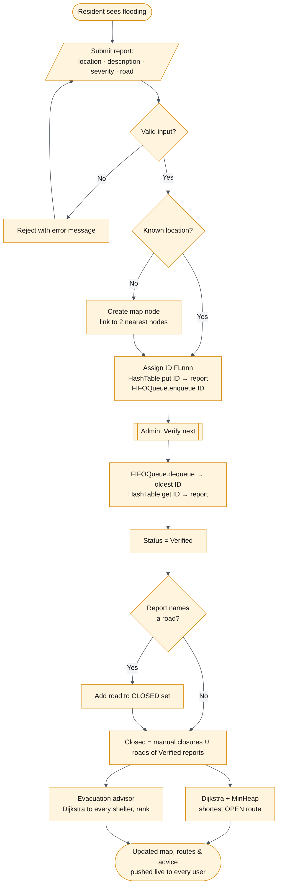
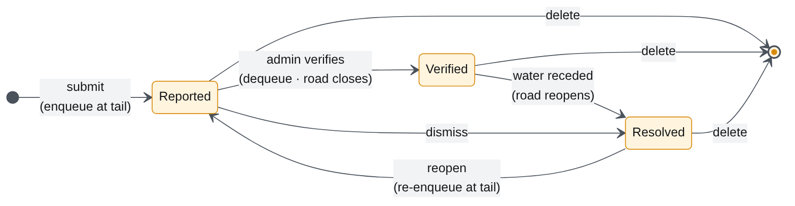
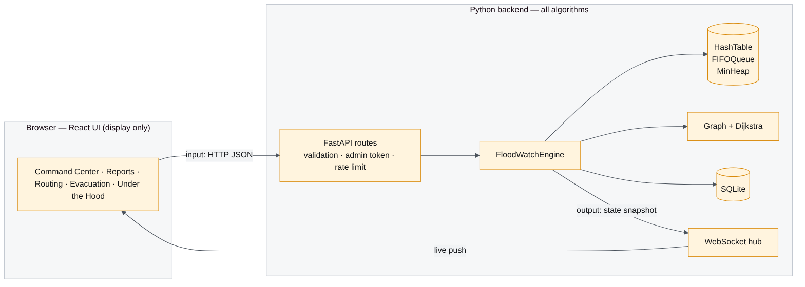
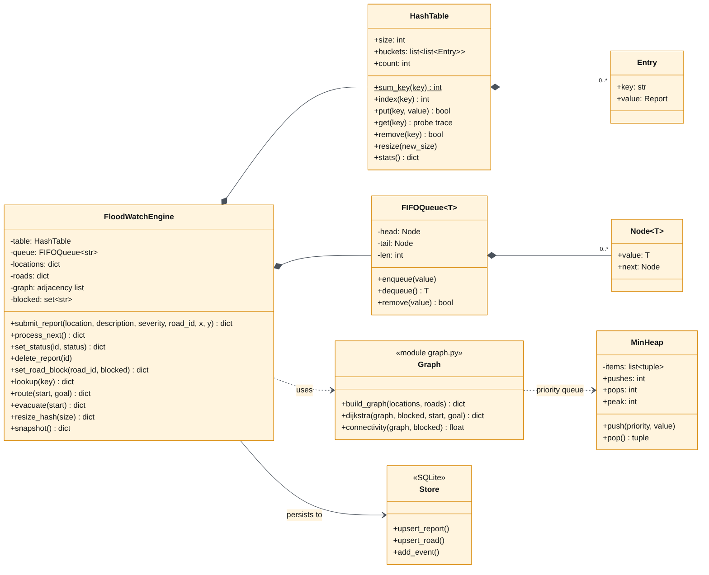
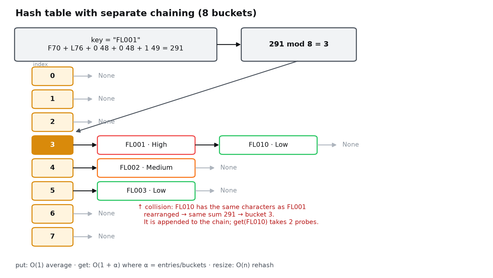
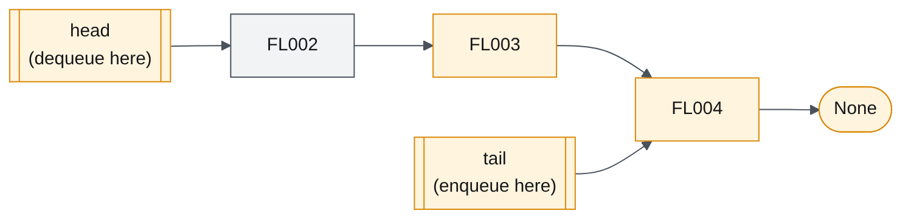
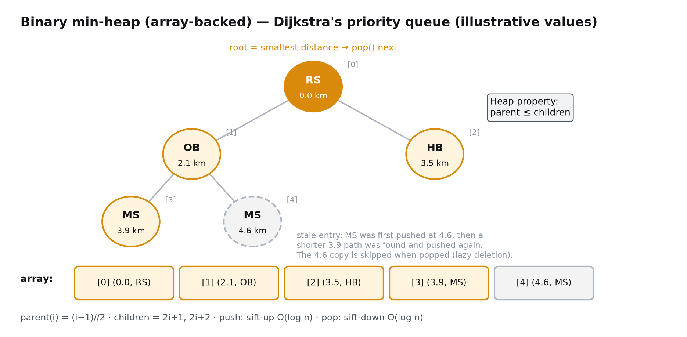
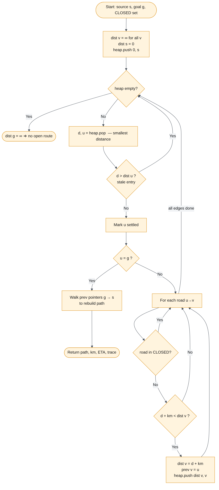
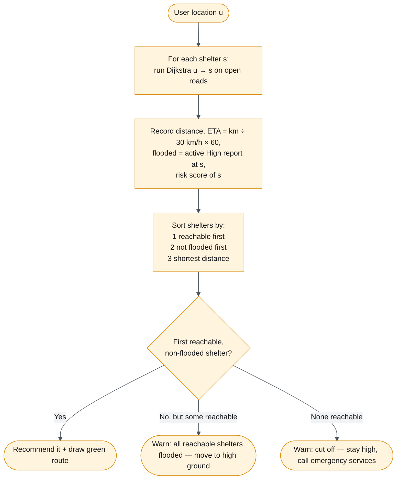
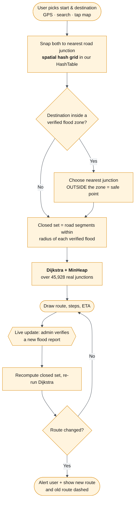

# FloodWatch: Concept, Algorithm & Data-Structure Design

**Course:** BDSA209 Data Structures and Algorithms (Semester Project, Steps 1 & 2)
**Implementation language:** Python 3 (all algorithms and data structures written from scratch)

---

## 1. Concept description

### 1.1 Problem statement

Heavy rain can flood city streets within minutes. During a flood, people need answers to three questions fast:

1. **Where is it flooded right now?** Information is scattered across phone calls, social media and word of mouth. Nobody holds one trustworthy picture.
2. **Which roads can I still use?** A route that is normally shortest may run straight through flood water. Driving or walking into flood water is a leading cause of injury in floods.
3. **Where is the nearest safe place I can actually reach?** The closest shelter is useless if every road to it is under water, or if the shelter itself is flooded.

**FloodWatch** turns reports from residents into a verified, live picture of the road network:

- Residents **report** flooding: location, severity and the road affected.
- An admin **verifies** reports in arrival order (first come, first served), so false or duplicate reports don't close roads.
- A verified report **closes its road** in a graph model of the city. In the **Ghana live map**, it closes every real road within a flood radius around the report's GPS position, anywhere in Ghana.
- **Dijkstra's shortest-path algorithm** finds the shortest route that uses only open roads.
- An **evacuation advisor** ranks shelters by how close and how safe they are.

### 1.2 Why it matters

- **It saves time when time matters most.** A route computed over open roads avoids the trial and error of driving into a flooded street and turning back.
- **The data is trusted.** The verification queue stops one false report from closing a road for everyone.
- **It scales to a real city.** Each part was chosen for its efficiency: lookup by ID, verification and route search stay fast as reports and roads grow. The benchmark results are in [TEST_REPORT.md](TEST_REPORT.md).

### 1.3 Concept overview

| Concept | Data structure / algorithm | Role in FloodWatch |
|---|---|---|
| Fast record storage and retrieval | **Hash table** with separate chaining | Stores every report by ID, giving O(1) average lookup |
| Fair, ordered processing | **Queue** (FIFO, linked list) | The admin verification queue: oldest report first |
| Shortest path on a weighted graph | **Dijkstra's algorithm** | Shortest open route between two places |
| Efficient "closest next" selection | **Binary min-heap** (priority queue) | Gives Dijkstra the nearest unsettled location in O(log n) |
| Road network | **Graph** stored as an adjacency list | Locations are vertices; roads are weighted, undirected edges (km) |
| Closed roads | **Set** | O(1) "is this road closed?" checks during the search |
| GPS → nearest road | **Spatial hashing** (grid cells stored in our hash table) | Snaps a phone's location to the road network in about 0.3 ms |
| Place-name search | **Binary search** over sorted names | Finds "Korle Bu…" among 17,343 Ghanaian places and landmarks in O(log n) |

### 1.4 Visual aids

**Figure 1: End-to-end system flowchart** (input → process → output)



**Figure 2: Report lifecycle (state diagram)**



**Figure 3: Architecture.** All algorithms run in Python; the browser only displays results.



**Figure 4: The demo road network** (8 locations, 12 roads; red dashed = closed road, amber = recommended route)


---

## 2. Data structure design

### 2.1 Class diagram



### 2.2 Hash table (separate chaining): report storage



| Design point | Decision | Reason |
|---|---|---|
| Key → value | Report ID (`FL001`) → report record | Admins and residents look reports up by ID |
| Hash function | `sum(ord(c) for c in key) mod size` | Easy to explain and calculate by hand on a slide; collisions are easy to show (`AB`/`BA`, `FL001`/`FL010`) |
| Collision handling | **Separate chaining**: each bucket holds a chain of entries | Never runs out of space; deletion is simple (no "tombstones" needed, unlike open addressing) |
| Resizing | Admin-selectable 5/8/11/13/17 buckets, with full rehash | Shows how load factor α changes chain length |
| Why not a Python `dict`? | The assignment is to *implement* the structure, and we need to expose probe counts and bucket layout for the visualiser | |

### 2.3 Queue (singly linked list): verification queue



| Design point | Decision | Reason |
|---|---|---|
| Order | First-in, first-out | Fair: reports are verified in the order they arrived |
| Representation | Singly linked list with `head` and `tail` pointers | `enqueue` at the tail and `dequeue` at the head are both **O(1)** |
| Why not a Python list? | `list.pop(0)` shifts every remaining element, which is O(n) per dequeue (measured as 22× slower at 100k items) | |

### 2.4 Binary min-heap: Dijkstra's priority queue



| Design point | Decision | Reason |
|---|---|---|
| Representation | Array; children of `i` are at `2i+1` and `2i+2` | No pointers needed; cache-friendly |
| Ordering | Smallest tentative distance at the root | Dijkstra always expands the closest unsettled location |
| Decrease-key | **Lazy deletion**: push again with the better distance, skip stale entries when popped | Simpler than tracking each node's heap position, with the same Big-O |
| Instrumentation | Counts pushes, pops and peak size | Shown in the app's "Algorithm trace" panel |

### 2.5 Graph (adjacency list): road network

- **Vertex** = location `{id, name, x, y, shelter?}`. **Edge** = road `{id, a, b, km}`. Edges are undirected.
- An **adjacency list** `node → [ {to, weight, road} ]` uses O(V + E) memory. Road networks are *sparse* (each junction connects to only a few roads), so an adjacency matrix (O(V²)) would mostly hold empty entries.
- Closures are a **set** of road IDs. They are kept separate from the graph, so closing or reopening a road is O(1) and the graph never has to be rebuilt.

---

## 3. Algorithms (pseudocode)

### 3.1 Submit a report

```
ALGORITHM SubmitReport(location, description, severity, roadId, pin)
  INPUT : text fields from the user; optional map pin (x, y)
  OUTPUT: new report record

  1  validate lengths, severity ∈ {High, Medium, Low}, roadId exists (if given)
  2  locId ← FIND location whose name or id equals `location` (case-insensitive)
  3  IF locId not found THEN
  4      locId ← CreateLocation(location, pin)            ▷ §3.6
  5  id ← "FL" + zero-pad(nextNumber, 3);  nextNumber ← nextNumber + 1
  6  report ← {id, location, locId, description, severity, status: "Reported", roadId}
  7  HashTable.PUT(id, report)                            ▷ O(1) average
  8  Queue.ENQUEUE(id)                                    ▷ O(1)
  9  persist report; broadcast new state to all clients
 10  RETURN report
```

### 3.2 Hash table operations

```
FUNCTION Hash(key, size)
  sum ← 0
  FOR each character c IN key DO  sum ← sum + ASCII(c)
  RETURN sum MOD size

PROCEDURE PUT(key, value)
  bucket ← buckets[Hash(key, size)]
  FOR each entry IN bucket DO
      IF entry.key = key THEN entry.value ← value; RETURN      ▷ update
  APPEND (key, value) TO bucket;  count ← count + 1

FUNCTION GET(key)
  i ← Hash(key, size);  steps ← 0
  FOR each entry IN buckets[i] DO
      steps ← steps + 1
      IF entry.key = key THEN RETURN (found, i, steps, entry.value)
  RETURN (not found, i, steps)

PROCEDURE RESIZE(newSize)
  old ← all entries;  size ← newSize;  buckets ← newSize empty lists;  count ← 0
  FOR each (k, v) IN old DO PUT(k, v)                         ▷ rehash, O(n)
```

### 3.3 Verify next report (queue processing)

```
ALGORITHM ProcessNext()
  LOOP
      id ← Queue.DEQUEUE()                          ▷ oldest report, O(1)
      IF id = NULL THEN FAIL "No reports waiting"
      r ← HashTable.GET(id)
      IF r.found THEN BREAK                         ▷ skip IDs deleted meanwhile
  r.status ← "Verified"
  RecomputeClosedRoads()
  RETURN r

PROCEDURE RecomputeClosedRoads()
  closed ← { road.id | road manually closed }
         ∪ { r.roadId | r in HashTable, r.status = "Verified", r.roadId ≠ NULL }
```

### 3.4 Dijkstra's shortest open route (see Figure 5)

```
ALGORITHM Dijkstra(G, closed, s, g)
  INPUT : adjacency list G, set of closed road IDs, source s, goal g
  OUTPUT: shortest open path s → g, its length, and a trace

  1  FOR each vertex v IN G DO dist[v] ← ∞
  2  dist[s] ← 0;  heap ← MinHeap();  heap.PUSH(0, s)
  3  WHILE heap not empty DO
  4      (d, u) ← heap.POP()                         ▷ closest unsettled vertex
  5      IF d > dist[u] THEN CONTINUE                ▷ stale entry (lazy deletion)
  6      mark u settled
  7      IF u = g THEN BREAK                         ▷ early exit
  8      FOR each edge (u → v, km, roadId) IN G[u] DO
  9          IF roadId ∈ closed THEN CONTINUE        ▷ flooded road
 10          IF d + km < dist[v] THEN                ▷ relaxation
 11              dist[v] ← d + km;  prev[v] ← u;  prevRoad[v] ← roadId
 12              heap.PUSH(dist[v], v)
 13  IF dist[g] = ∞ THEN RETURN "no open route"
 14  path ← [g];  WHILE path.first ≠ s DO prepend prev[path.first]
 15  RETURN path, dist[g], ETA = dist[g] / 30 km/h, trace
```

**Figure 5: Dijkstra flowchart**



**Worked example (demo data):** Riverside (RS) → Hillcrest (HC), with RS-MS and HJ-HC closed.

| Step | Pop (d, u) | Relaxations | Heap after |
|---|---|---|---|
| 1 | (0, RS) | OB = 2.1, HB = 3.5 (RS-MS skipped: closed) | (2.1 OB), (3.5 HB) |
| 2 | (2.1, OB) | MS = 2.1 + 1.8 = 3.9 | (3.5 HB), (3.9 MS) |
| 3 | (3.5, HB) | AP = 3.5 + 6.8 = 10.3 (MS via HB = 6.3, not better) | (3.9 MS), (10.3 AP) |
| 4 | (3.9, MS) | HJ = 5.1, HC = 6.9, UG = 7.0 | (5.1 HJ), (6.9 HC), … |
| 5 | (5.1, HJ) | HC via HJ: HJ-HC is closed, skipped | (6.9 HC), … |
| 6 | (6.9, HC) | **goal reached**, stop | |

**Result:** RS → OB → MS → HC = **6.9 km**, about 14 min. This matches the app and automated test #15.

### 3.5 Evacuation advisor

```
ALGORITHM Evacuate(u)
  options ← []
  FOR each shelter s DO
      r ← Dijkstra(G, closed, u, s)
      flooded ← EXISTS active High-severity report at s
      APPEND {s, r.found, r.distance, flooded, Risk(s)} TO options
  SORT options BY (not found, flooded, distance)            ▷ reachable, safe, near
  best ← first option WITH found AND NOT flooded
  IF best exists        THEN advise "go to best"
  ELSE IF any found     THEN advise "all reachable shelters flooded: move to high ground"
  ELSE                       advise "cut off: stay high, call emergency services"

FUNCTION Risk(v)
  score ← Σ weight(severity) over active reports at v      ▷ High 3, Medium 2, Low 1
        + number of closed roads touching v
  RETURN Safe (0) | Watch (≤2) | Warning (≤4) | Danger (>4)
```



### 3.6 Adding a new location to the map

```
ALGORITHM CreateLocation(name, pin)
  id ← initials(name) made unique (KM, KM2, …)
  IF pin given THEN (x, y) ← pin
  ELSE (x, y) ← among 80 candidate points (seeded by name), the one farthest
                 from every existing location                  ▷ avoids overlap
  add vertex; connect it to its 2 nearest vertices, km = pixel distance ÷ 85
```

### 3.7 Network connectivity (KPI)

```
ALGORITHM Connectivity(G, closed)
  find connected components over open roads with iterative DFS     ▷ O(V + E)
  RETURN Σ size·(size−1) over components  ÷  V·(V−1)               ▷ 1.0 = fully connected
```

### 3.8 Ghana live map: same algorithms on real roads

The live map runs the **unchanged** `dijkstra()` and `HashTable` on Ghana's real road network, built from OpenStreetMap by `tools/build_ghana_graph.py`.

**Graph construction (offline, one time).** Keep drivable national, regional and district roads. Split each road wherever it meets another road, so every junction becomes a **vertex**. Each piece between two junctions becomes a weighted **edge**, with its length in metres from the haversine formula. Keep the largest connected component. Result: 45,928 vertices, 56,382 edges, 76,620 km of road.



```
ALGORITHM NearestJunction(lat, lon)                      ▷ spatial hashing, our HashTable
  (r, c) ← (⌊lat / 0.02⌋, ⌊lon / 0.02⌋)                  ▷ grid cell ≈ 2.2 km
  FOR k ← 0, 1, 2, … DO                                  ▷ search rings of cells outward
      FOR each cell on ring k DO
          FOR each junction j IN HashTable.GET("r:c") DO
              keep j if haversine(point, j) < best
      IF best found AND best < k × cellSize THEN RETURN best   ▷ nothing nearer can exist

ALGORITHM FloodClosures(reports)
  closed ← ∅
  FOR each report r WITH GPS AND status = Verified DO
      radius ← {High: 400 m, Medium: 200 m, Low: 80 m}[r.severity]
      FOR each road segment e indexed in the grid cells around r DO
          IF distance(r, any piece of e's shape) ≤ radius THEN closed ← closed ∪ {e}
  RETURN closed

ALGORITHM SafeRoute(start, destination)
  closed ← FloodClosures(all reports)
  IF start lies inside zone Z THEN closed ← closed − FloodClosures({Z})   ▷ let people get out
  s ← NearestJunction(start)
  IF destination lies inside a verified zone THEN
      t ← nearest junction to destination that is OUTSIDE every zone      ▷ "safe point"
      warn "destination flooded"
  ELSE t ← NearestJunction(destination)
  RETURN Dijkstra(G, closed, s, t)                        ▷ the same function as §3.4

ON EVERY LIVE UPDATE (a report verified or resolved):
  re-run SafeRoute for the active trip; IF its roads changed THEN alert the user and redraw

ALGORITHM SearchPlaces(query)                             ▷ binary search
  keys ← every suffix of words in every place name, sorted ("korle bu teaching hospital", "teaching hospital", …)
  lo ← LowerBound(keys, query);  hi ← LowerBound(keys, query + "\uffff")
  RETURN places for keys[lo:hi], ranked (exact match, city/town first, shorter name)
```

**Hash-function decision backed by our own measurements.** The benchmark in TEST_REPORT §3.2 showed the char-sum hash clusters badly on large key sets. The map indexes (grid keys like `"278:-10"`) therefore use `HashTable(…, hash_fn="poly")`, a polynomial rolling hash added as an option. The reports table keeps the original char-sum hash.

---

## 4. Complexity analysis

V = locations, E = roads, n = reports, α = n / buckets, S = shelters.

| Operation | Time | Space | Justification |
|---|---|---|---|
| Hash `PUT` / `GET` | O(1 + α) average, O(n) worst | O(n + buckets) | Hash in O(key length), then walk one chain whose expected length is α |
| Rehash | O(n) | O(n) | Every entry is inserted again |
| Queue enqueue / dequeue | **O(1)** | O(n) | Pointer updates at the tail / head only |
| Queue remove(id) | O(n) | | Linear search (only on delete or a direct status change) |
| Heap push / pop | **O(log n)** | O(n) | Sift-up / sift-down along one root-to-leaf path |
| **Dijkstra** | **O((V + E) log V)** | O(V + E) | Each edge is relaxed at most once, each causing one O(log V) push; at most E + 1 pops |
| Evacuation | O(S · (V + E) log V) | O(V) | One Dijkstra per shelter (S = 4 in the demo) |
| Recompute closures | O(n + E) | O(E) | Scan reports and roads |
| Connectivity | O(V + E) | O(V) | One DFS visit per vertex and edge |
| Submit report | O(1) average (+ O(V) if a new location is created) | | Hash put + enqueue; a new location scans for its 2 nearest |
| Snap GPS to road (Ghana map) | O(k² · m), effectively O(1) | O(V) | k rings of grid cells, m junctions per cell (≈3) |
| Flood closures (Ghana map) | O(Z · e) | O(E) | Z verified zones × e road segments in nearby cells |
| Place search | O(log n + matches) | O(n) | Two binary searches over n sorted keys |

**Why Dijkstra (and not BFS or Bellman-Ford)?**

- Roads have different lengths, so **BFS** (which counts hops, not kilometres) would give wrong answers.
- Distances are never negative, so Dijkstra is correct. **Bellman-Ford**, at O(V·E), would be needlessly slow.
- **A\*** could be faster with a straight-line-distance heuristic. It is listed as a future improvement.

**Measured performance** (full details in [TEST_REPORT.md](TEST_REPORT.md)):

- The heap version of Dijkstra is 33.6× faster than an O(V²) scan at 5,000 locations.
- The linked-list queue is 22× faster than `list.pop(0)` at 100k reports.
- The char-sum hash only uses 28 buckets for 2,000 `FLxxxx` IDs. A polynomial hash is the recommended upgrade.

---

## 5. Code organisation (input → process → output)

| File | Responsibility | Stage |
|---|---|---|
| `backend/app/main.py` | HTTP/WebSocket endpoints, input validation, admin auth | **Input** |
| `backend/app/engine.py` | Business rules: submit, verify, close roads, route, evacuate | **Process** |
| `backend/app/structures.py` | `HashTable`, `MinHeap`, `FIFOQueue` | **Process** |
| `backend/app/graph.py` | `build_graph`, `dijkstra`, `connectivity` | **Process** |
| `backend/app/store.py` | SQLite persistence | Process (storage) |
| `backend/app/seed.py` | Demo city data | Input (initial data) |
| `backend/app/geo.py` | Ghana map: spatial hashing, flood zones, safe routing, search, evacuation | **Process** |
| `backend/tools/build_ghana_graph.py` | One-time OpenStreetMap → graph conversion | Input (data preparation) |
| `frontend/src/…` | Maps, tables, animations | **Output** (display only) |
| `backend/tests/` | 46 automated tests | Verification |
| `backend/bench/` | Benchmarks and diagram generation | Analysis |
