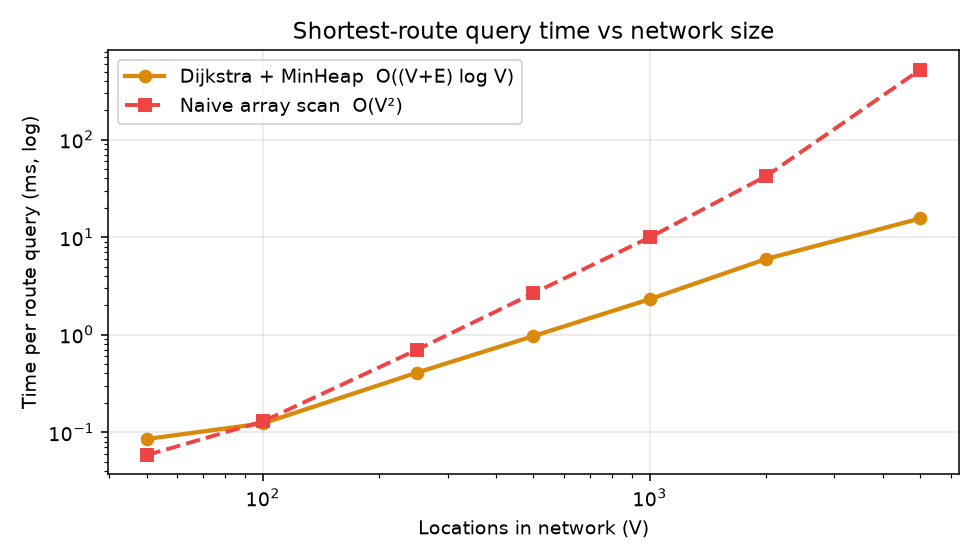
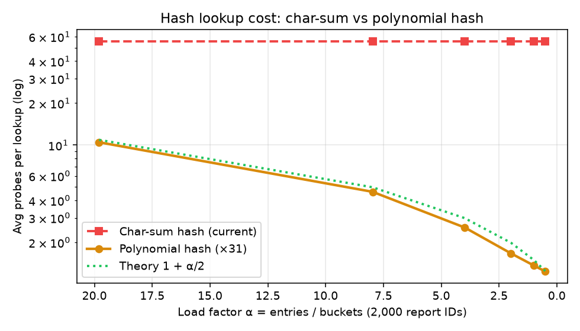
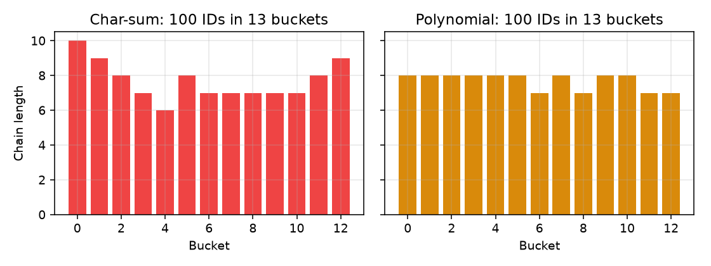
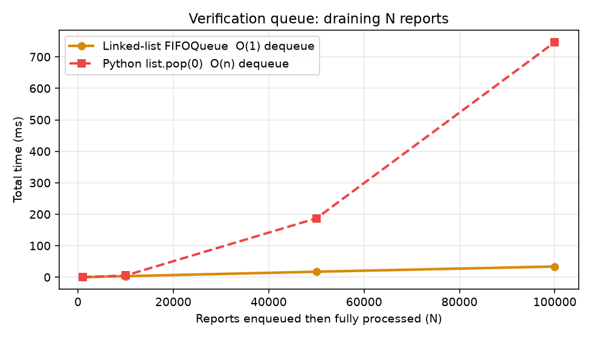

# FloodWatch: Test & Performance Report

**Course:** BDSA209 Data Structures and Algorithms (Semester Project, Step 3: Testing)
**Build tested:** FloodWatch 2.0
**Environment:** Python 3.13, x86-64 Linux

How to reproduce:

```bash
pip install -r requirements-dev.txt
cd backend
python -m pytest -v             # functional + edge-case + Ghana-map tests → docs/test-results.txt
python -m bench.benchmark       # performance experiments       → docs/benchmarks/
```

---

## 1. Summary

| Metric | Result |
|---|---|
| Automated tests | **46 / 46 passed** (≈3 s total) |
| Test files | `test_structures.py` (6), `test_api.py` (7), `test_edge_cases.py` (24), `test_geo.py` (9, real Ghana road network) |
| Randomised cross-check | Dijkstra matched an independent reference on **200 random graphs** (2–25 nodes, random closures) for every destination |
| Largest network benchmarked | 5,000 locations / 9,335 roads: route query in **15.5 ms** (33.6× faster than naive O(V²)) |
| Typical request on the demo network | Route 0.01 ms · Evacuation 0.06 ms · Report submit 0.70 ms (incl. SQLite write) |
| **Real Ghana road network** | 45,928 junctions · 56,382 road segments · 76,620 km. Accra → Tamale (564 km) in **151 ms** with the same Dijkstra |

The raw pytest output is in [`test-results.txt`](test-results.txt). The raw benchmark numbers are in [`benchmarks/results.json`](benchmarks/results.json).

---

## 2. Functional test cases

### 2.1 Data structures

| # | Case | Input | Expected | Result |
|---|---|---|---|---|
| 1 | Hash collision | Keys `AB`, `BA` (same char sum) in 5 buckets | Same bucket; `BA` found on probe 2; collisions = 1 | ✅ Pass |
| 2 | Hash update | `put("AB", 9)` on existing key | Value replaced, count unchanged | ✅ Pass |
| 3 | Hash remove | Remove existing key, then remove again | `True`, then `False`; count decremented once | ✅ Pass |
| 4 | Rehash | 20 keys, resize 5 → 13 buckets | All 20 retrievable with correct values | ✅ Pass |
| 5 | **Edge:** 1 bucket | 50 keys in a 1-bucket table | One chain of 50; last key takes 50 probes; all found | ✅ Pass |
| 6 | **Edge:** empty table | Lookup `FL001` on empty table | Not found, 0 probes | ✅ Pass |
| 7 | **Edge:** remove mid-chain | Remove `B` from chain `A→B→C` | `A` and `C` still found | ✅ Pass |
| 8 | **Edge:** invalid size | `HashTable(0)` | `ValueError` | ✅ Pass |
| 9 | Heap order | Push 5,1,4,2,3,0 | Pops 0,1,2,3,4,5; empty pop → `None` | ✅ Pass |
| 10 | **Edge:** heap duplicates / single item | Equal priorities; one element | All returned; single push/pop works | ✅ Pass |
| 11 | Heap vs `heapq` | 2,000 random floats | Identical sorted output | ✅ Pass |
| 12 | Queue FIFO | Enqueue a,b,c,d; remove d; enqueue e | Dequeue order a,b,c,e | ✅ Pass |
| 13 | **Edge:** remove queue tail | Remove tail, then enqueue | Tail pointer repaired; order 1,2,4 | ✅ Pass |
| 14 | **Edge:** queue becomes empty | Remove only item; remove missing item | Empty and reusable; missing → `False` | ✅ Pass |

### 2.2 Routing (Dijkstra)

| # | Case | Input | Expected | Result |
|---|---|---|---|---|
| 15 | Baseline (matches original Tkinter app) | RS → HC, RS-MS & HJ-HC closed | RS→OB→MS→HC, **6.9 km** | ✅ Pass |
| 16 | Detour around a closure | RS → MS with RS-MS closed | RS→OB→MS, 3.9 km (not the 2.9 km direct road) | ✅ Pass |
| 17 | **Edge:** start = destination | RS → RS | Found, path `[RS]`, 0 km, 0 min | ✅ Pass |
| 18 | **Edge:** isolated start | RS → AP with all 3 RS roads closed | No route; only RS settled | ✅ Pass |
| 19 | **Edge:** every road closed | RS → AP | No route; exactly 1 heap push | ✅ Pass |
| 20 | **Edge:** unknown node | RS → ZZ | `KeyError` (API: HTTP 404) | ✅ Pass |
| 21 | **Randomised correctness** | 200 random graphs × every destination | Distance equals the reference; every path step uses an open road that exists | ✅ Pass |
| 22 | Connectivity KPI bounds | No closures / all closed / single node | 1.0 / 0.0 / 1.0 | ✅ Pass |

### 2.3 Application behaviour (via the REST API)

| # | Case | Expected | Result |
|---|---|---|---|
| 23 | Demo data loads | 3 active reports, 2 closed roads, queue `[FL001, FL002, FL003]` | ✅ Pass |
| 24 | Admin protection | No token / wrong token → 401 | ✅ Pass |
| 25 | Full lifecycle | Submit → verify (road RS-OB closes) → route avoids RS-OB → resolve (road reopens) | ✅ Pass |
| 26 | Custom location | Unknown place creates a node with 2 links and is routable | ✅ Pass |
| 27 | Lookup / resize / delete / clear | Lookup bucket = sum mod 8; invalid size 7 → 400; double delete → 404; empty queue → 409 | ✅ Pass |
| 28 | Evacuation | Best option is first and marked *Recommended* | ✅ Pass |
| 29 | **Edge:** evacuate from a shelter | From UG → UG, 0 km | ✅ Pass |
| 30 | **Edge:** flooded shelter avoided | High report at HJ makes the advisor pick another shelter | ✅ Pass |
| 31 | **Edge:** invalid inputs | Bad severity, whitespace-only text, 61-char name, negative coordinates → 422; unknown road → 400; bad status → 422; unknown report/road → 404 | ✅ Pass |
| 32 | **Edge:** re-opened report | Goes to the **tail** of the queue | ✅ Pass |
| 33 | **Edge:** two reports on one road | Road stays closed until **both** are resolved | ✅ Pass |
| 34 | **Edge:** similar custom names | "Kaneshie Market" and "Kotobabi Market" get different IDs; "kaneshie market" reuses the first | ✅ Pass |
| 35 | **Edge:** IDs after *Clear all* | Next ID continues (FL004), never reuses FL001 | ✅ Pass |
| 36 | Rate limiting | 3rd submission in a minute with limit 2 → 429 | ✅ Pass |
| 37 | **Persistence** | After a simulated restart, queue order, verified closures, hash size, next ID and custom locations are all restored | ✅ Pass |
| — | Live updates | A WebSocket client receives a new snapshot after a submission | ✅ Pass |

### 2.4 Ghana real-map mode (`test_geo.py`)

These run on the real road network built from OpenStreetMap. They use **the same `dijkstra()` and `HashTable`**.

| # | Case | Expected | Result |
|---|---|---|---|
| 38 | Binary-search prefix range | `prefix_range(["…kaneshie", "kaneshie market"…], "kaneshie")` returns exactly those two; missing prefix → empty range | ✅ Pass |
| 39 | Polynomial hash on 2,500 grid keys | Uses >20× more buckets than char-sum (≈600 vs 26); longest chain <1/10 of char-sum's (214) | ✅ Pass |
| 40 | Network loaded + place search | >40,000 junctions, >50,000 km of road; "korle bu" finds Korle Bu Teaching Hospital; "Kumasi" ranks the city first | ✅ Pass |
| 41 | Accra → Kumasi route | Found, 200–320 km (got 246.8 km); both ends snap within 1 km of a road; drawn line is continuous | ✅ Pass |
| 42 | **Flood reroute lifecycle** | Unverified report → route unchanged. Verified High report on the route → roads closed, new path never enters the zone, distance ≥ before. Resolved → original route restored | ✅ Pass |
| 43 | **Edge:** destination inside a flood zone | `destinationFlooded = true`; route ends at a safe point >200 m from the zone centre, with a warning | ✅ Pass |
| 44 | **Edge:** start inside a flood zone | Route still found (roads in your own zone stay open so you can get out), with a warning | ✅ Pass |
| 45 | Evacuation + bounds | Nearest reachable safe place is *Recommended* with a drawn route; coordinates outside Ghana → 422 for routes and reports | ✅ Pass |
| 46 | GPS report = same hash table + queue; survives restart | Hash lookup finds it with its lat/lon; it is in the FIFO queue; lat/lon reload from SQLite | ✅ Pass |

---

## 3. Performance observations

### 3.1 Dijkstra: binary min-heap vs naive O(V²)

The networks are road-like: each location is linked to its 3 nearest neighbours, so E ≈ 1.9 V. The destination is the farthest reachable node (the worst case), and each figure is the median of 5 starting points.

| Locations V | Roads E | **MinHeap (ms)** | Naive scan (ms) | Speed-up |
|---|---|---|---|---|
| 50 | 99 | 0.085 | 0.058 | 0.7× |
| 100 | 190 | 0.123 | 0.129 | 1.0× |
| 250 | 462 | 0.408 | 0.700 | 1.7× |
| 500 | 938 | 0.967 | 2.658 | 2.7× |
| 1,000 | 1,873 | 2.314 | 9.969 | 4.3× |
| 2,000 | 3,764 | 5.983 | 42.39 | 7.1× |
| 5,000 | 9,335 | **15.55** | 522.25 | **33.6×** |



**Observations**
- Going from 1,000 to 5,000 locations (5× the size), the heap version slows down about 6.7×. That fits O((V+E) log V). The naive version slows down about 52×, which fits O(V²).
- **Below about 100 locations the naive version is as fast or faster.** The heap has extra work per step, and scanning a short list is cheap. The demo city has 8–40 locations, so either would feel instant. The heap is the right choice because it **keeps working as the network grows**.
- Lazy deletion (pushing a node again instead of decrease-key) adds stale heap entries, but the code that skips them is simple and fast. On the demo route RS→HC there were 8 pushes for 6 settled nodes.

### 3.2 Hash table: char-sum hash vs polynomial hash

There are 2,000 report IDs (`FL0001`–`FL2000`). Probes are the average chain length walked per successful lookup.

| Buckets | Load factor α | **Char-sum probes** | Buckets actually used | Polynomial probes | Theory 1+α/2 |
|---|---|---|---|---|---|
| 101 | 19.80 | 55.5 | 28 | 10.47 | 10.90 |
| 251 | 7.97 | 55.5 | 28 | 4.62 | 4.98 |
| 503 | 3.98 | 55.5 | 28 | 2.56 | 2.99 |
| 1,009 | 1.98 | 55.5 | 28 | 1.67 | 1.99 |
| 2,003 | 1.00 | 55.5 | 28 | 1.37 | 1.50 |
| 4,001 | 0.50 | 55.5 | 28 | 1.24 | 1.25 |




**Observations (the key finding of this report)**
- **The char-sum hash does not scale for our ID format.** Every ID has the form `FL` + 4 digits, so the sum of character codes always falls between 338 (`FL0000`) and 374 (`FL9999`). That allows at most **37 distinct values**, and only 28 occur for FL0001–FL2000. However many buckets we add, only 28 are ever used, so a lookup costs about 55 probes. Adding buckets doesn't help at all.
- **At the demo's real scale it works well.** With 100 reports in 13 buckets the chains are reasonably even (6–10 per bucket, bottom-left chart). The simple hash is still a good choice for *teaching* collisions: `AB` and `BA` visibly collide in the app.
- A **polynomial hash** (h = h·31 + c) matches the theory curve 1 + α/2 for uniform hashing, at every load factor tested.
- **Recommended improvement:** switch `HashTable.index` to the polynomial hash and resize automatically when α > 0.75. It's a one-function change, and the benchmark shows the effect.

### 3.3 Verification queue: linked list vs Python `list.pop(0)`

| Reports N | **Linked-list FIFOQueue (ms)** | `list.pop(0)` (ms) |
|---|---|---|
| 1,000 | 0.27 | 0.06 |
| 10,000 | 3.34 | 5.48 |
| 50,000 | 17.44 | 187.03 |
| 100,000 | **34.04** | 746.72 |



**Observations**
- Draining the linked-list queue grows **linearly** with N (O(1) per dequeue). With `list.pop(0)`, every dequeue shifts all remaining items, so total work grows **quadratically**. At 100k reports it is 22× slower.
- For small queues (≈1,000), `list.pop(0)` is faster. It runs as one optimised C operation, while each of our dequeues is a Python step. The O(1) design pays off once queues get large.

### 3.4 End-to-end operations on the demo network

| Operation | Median time |
|---|---|
| Route RS→AP (Dijkstra) | 0.010 ms |
| Evacuate from RS (4 × Dijkstra, one per shelter) | 0.057 ms |
| Hash lookup FL002 | 0.002 ms |
| Full state snapshot (sent to every browser on change) | 0.039 ms |
| Submit report (hash put + enqueue + SQLite write) | 0.701 ms |

The algorithms themselves take microseconds. Submitting a report is dominated by the SQLite write to disk, which keeps the data safe. Everything in the app responds well under 1 ms on the server.

### 3.5 Real Ghana road network (same Dijkstra, no changes)

The graph was built from the OpenStreetMap Ghana extract: motorway → tertiary and unclassified roads, split at every junction. It has 45,928 junctions, 56,382 segments and 76,620 km of road; Ghana's official road network is roughly 78,000 km, so the coverage is realistic. Each figure is the median of 5 runs.

| Trip | Road km | Junctions settled | Heap pushes | Time |
|---|---|---|---|---|
| Accra Central → Korle Bu (in town) | 3.1 | 599 | 696 | **4 ms** |
| Accra → Kumasi | 246.8 | 21,443 | 23,393 | **78 ms** |
| Accra → Tamale | 564.4 | 38,328 | 41,327 | **151 ms** |
| Takoradi → Bolgatanga (south-west → far north) | 785.9 | 42,304 | 45,678 | **200 ms** |

| Map operation | Structure | Median time |
|---|---|---|
| Snap a GPS point to the nearest road junction | Spatial grid in our `HashTable` (polynomial hash, 13,972 cells, α = 0.85, longest chain 5) | 0.29 ms |
| Place search ("korle bu", "kumasi"…) | Binary search over 40k sorted name keys | 0.04–0.56 ms |
| Load the whole Ghana network at start-up | Build graph + 3 spatial indexes | ≈0.8 s |

**Observations**
- Early exit matters. A trip inside a city settles only about 600 of 45,928 junctions (1.3%) and finishes in 4 ms. Cross-country trips settle most of the network but still finish within 0.2 s.
- The finding from §3.2 led to a design decision. The big map indexes use a **polynomial hash**, and they spread almost exactly as theory predicts. With 0.85 entries per bucket, theory expects about 9,380 of 16,381 buckets to be used; we measured 9,650. The longest chain is 5. The reports table keeps the original char-sum hash, so the classroom collision demo still works.

---

## 4. Conclusions

1. **Correctness:** all 46 tests pass, including 24 edge cases, a 200-graph randomised cross-check of Dijkstra against an independent reference, and 9 tests on the real Ghana road network.
2. **Efficiency:** the min-heap and the linked-list queue scale as their Big-O analysis predicts. Below about 100 items the simpler alternatives are just as fast, which is an expected and honest result.
3. **Limitation found and acted on:** the char-sum hash only produces 28 distinct values for `FLxxxx` IDs. It is fine at demo scale but would degrade badly at city scale. The new Ghana map indexes therefore use the polynomial hash, which tracks the theoretical curve. Switching the reports table to it with automatic resizing is the remaining step.
